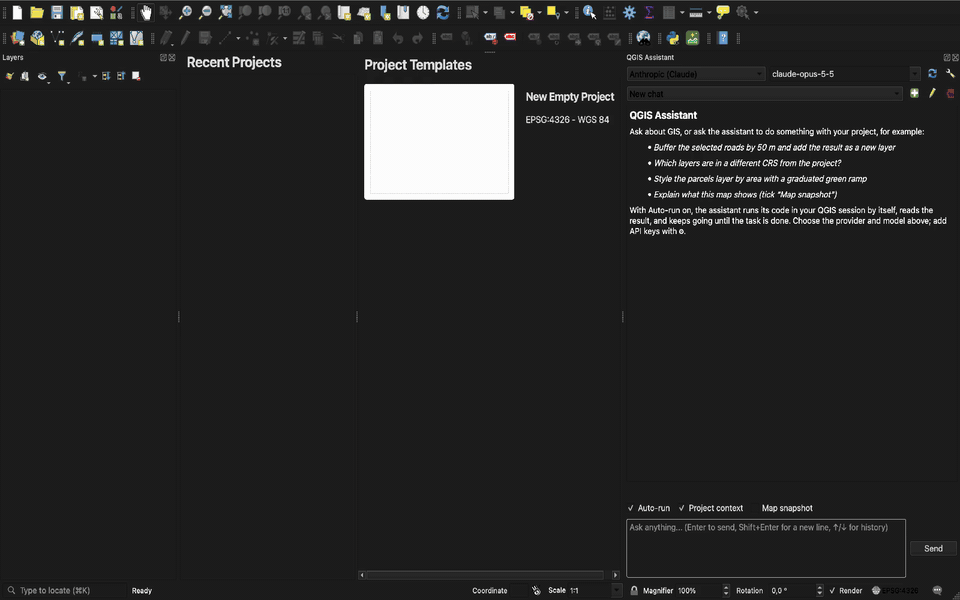

# QGIS Assistant

A QGIS plugin that adds an AI chat panel to QGIS. It works with Claude, GPT, Gemini, Mistral, Llama and other models. It knows about your project, and Python code in its answers can be run with one click.

## Providers

| Provider | Protocol | Key |
|---|---|---|
| Anthropic (Claude) | Messages API | `ANTHROPIC_API_KEY` or Settings |
| Claude Code CLI (your Claude subscription) | `claude` command | none: sign in once with `claude` |
| OpenAI | Chat Completions | `OPENAI_API_KEY` or Settings |
| Google Gemini | Generative Language API | `GEMINI_API_KEY` or Settings |
| Mistral, Groq, DeepSeek, xAI | OpenAI-compatible | Settings |
| OpenRouter (hundreds of models) | OpenAI-compatible | Settings |
| Ollama, LM Studio (local, free) | OpenAI-compatible | none |
| Custom endpoint (vLLM, LiteLLM, Azure proxy...) | OpenAI-compatible | optional |

Click ↻ next to the model box to fetch the provider's current model list. You can also type any model id.

**Claude without an API key:** install [Claude Code](https://claude.com/product/claude-code), run `claude` once in a terminal and sign in with your Claude account, then pick **Claude Code CLI** in the panel. Requests use your Claude plan. The plugin finds `claude` on its own (PATH, the usual install folders, or the VS Code extension); if it can't, put its path in Settings. Claude Code's own tools are turned off: the model only writes code, and the plugin runs it as with any other provider.

## Features

- **Multiple chats**: start a new chat with ＋, switch between chats from the chat list, and rename ✎ or delete 🗑 them. Each chat keeps its own history and its own Python variables. Chats are saved in your QGIS profile (`qgis_ai_assistant/chats.json`) and come back after a restart. Map images are not stored.
- **Streaming chat** in a dock panel. You can switch provider or model in the middle of a conversation.
- **Project context**: each message can carry a snapshot of the layers, geometry types, fields, CRS, extent, selection and active layer. No attribute values are sent; when the agent needs to see data it inspects it with code.
- **Map snapshot**: attach an image of the map canvas for vision-capable models.
- **Auto-run (agent mode, on by default)**: the assistant runs its own PyQGIS code in your session, reads the output or traceback, and keeps going (inspect, act, fix its errors, check) until the task is done, then replies with a summary. It takes at most 10 steps per request, and **Stop** halts it. QGIS stays usable while the code runs: Processing algorithms run in the background like in the Processing toolbox, the status bar shows the elapsed time and progress, and **Stop** also interrupts code that is still running. With Auto-run off, code gets a **▶ Run in QGIS** link instead.
- **Remembers your preferences**: when you tell the assistant to stop doing something, or keep asking for the same thing after every answer, it saves that as a preference on your computer (`qgis_ai_assistant/memory.json` in your QGIS profile) and follows it in every chat. Each saved preference appears in the chat with an **Undo** link. You can review, delete or turn off learning in ⚙ Settings → Memory.
- **38 interface languages**: every language QGIS itself ships, from Arabic to Chinese. The plugin starts in your operating system's language, and you can change it in ⚙ Settings → Language.
- **Keys** are stored in the QGIS authentication database, encrypted with your master password. Environment variables also work.
- **No extra Python packages.** All requests go through QGIS's own network stack, so QGIS proxy and SSL settings apply.

## Installation

### What you need

- **QGIS 3.22 or newer, including QGIS 4,** on Windows, macOS or Linux.
- **One of these:**
  - an API key from an AI provider, such as [Anthropic](https://console.anthropic.com/settings/keys), [OpenAI](https://platform.openai.com/api-keys) or [Google Gemini](https://aistudio.google.com/apikey). Using a provider's API is usually paid per use.
  - [Ollama](https://ollama.com) installed on your computer, which runs free AI models locally with no key.

### Install the plugin

1. Go to the **[Releases](../../releases)** page of this repository and download `qgis_assistant.zip` from the latest release. **Do not unzip it.**
   > On macOS, Safari may unzip downloads automatically. If you end up with a folder instead of a `.zip` file, download it again with another browser. You can also turn off *Safari → Settings → General → Open "safe" files after downloading*.
2. Open QGIS and go to **Plugins → Manage and Install Plugins…**
3. Choose **Install from ZIP** in the left-hand list.
4. Click **…**, select the `qgis_assistant.zip` file you downloaded, and click **Install Plugin**.
5. QGIS warns that plugins from outside the official repository may be unsafe. Click **Yes** to continue.
6. When the installation finishes, close the Plugins window. A **QGIS Assistant** button appears in the toolbar, and an entry is added to the **Plugins** menu.

## License

Released under the [MIT License](LICENSE).
